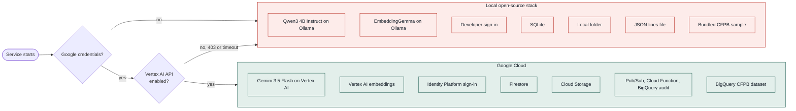
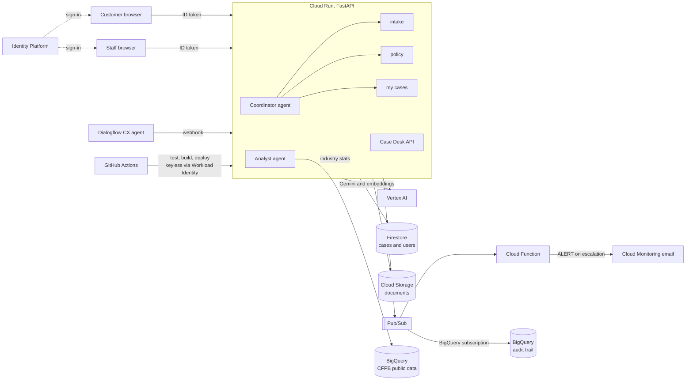

# Northwind Resolve

**Live: https://complaint-agent-1045201542246.us-central1.run.app**
([status page](https://complaint-agent-1045201542246.us-central1.run.app/status): which stack it's running on, and why)

Northwind Resolve is the complaint-handling system of a retail bank. When a customer has a problem with
their money, they tell an AI assistant. The assistant turns it into a case with the right urgency and the
right legal deadline, and a specialist resolves it before that deadline. The customer follows the outcome
without calling in, and managers see where complaints come from.

Northwind Bank is fictional. The regulations, deadlines and industry complaint data are real.

## Why this app

US banks must answer complaints within legal deadlines: Regulation E gives 10 business days to
investigate a disputed card charge, and the CFPB expects a response within 15 days. Missing them
leads to regulatory findings. That makes complaint handling a good place to put AI to work, with the
controls a regulated business needs around it:

- **AI does the busywork.** It takes the complaint in plain language, triages it, and finds the rules
  and deadline that apply.
- **People make the decisions.** Every case records what the model suggested and which model suggested
  it. Specialists can overrule the urgency or the rules, and each override is logged.
- **Everything is on the record.** Every case event goes to BigQuery as an audit trail that compliance
  can query.
- **It doesn't depend on one cloud.** The same app runs without Google Cloud on open-source models (see
  [the runtime check](#the-runtime-check-google-cloud-or-a-local-open-source-stack)). A bank can run it
  on-premises, or keep cloud credits for other teams.

## Who uses it, and how

| Role | Page | What they do there |
|---|---|---|
| Customer | **My account** (`/app`) | Chat with the assistant to ask about fees, disputes or their rights, or to report a problem. Attach statements to a case. Follow their cases and the bank's replies. |
| Complaint specialist | **Case Desk** (`/desk`) | Work the queue of open cases, sorted by legal deadline. Check or overrule the AI triage, read attached documents, reply to the customer, add internal notes, change status. |
| Operations or compliance lead | **Insights** (`/insights`) | See deadline risk at a glance, and ask an analyst agent about trends, risky cases, and how Northwind compares with the industry. |

### One complaint, end to end

1. **The customer signs in and describes the problem**, for example "two $480 debit charges I never made".
   A coordinator agent hands the conversation to the intake agent. It asks at most one round of
   questions, then files a case owned by that customer, with product, issue, urgency and the rules that
   apply (here Reg E). The customer can attach a bank statement to the case.
2. **The case gets its legal deadline.** That's 10 business days for Reg E errors and 15 days for
   everything else. High-urgency cases publish an `escalated` event, and Cloud Monitoring emails the
   compliance team.
3. **A specialist picks it up in the Case Desk.** Overdue and nearly-due cases are at the top. The
   specialist checks the AI triage (and can overrule it), opens the statement, replies to the customer,
   adds an internal note and moves the case to *in review*.
4. **The customer sees the reply** under My account, or asks the assistant "where do my cases stand?".
   The assistant can only read that customer's own cases.
5. **The lead watches the trends** in Insights. For example "2 cases are past their legal deadline", or
   "compare our credit card complaints with the industry", answered from BigQuery's CFPB dataset.

Customers can also ask policy questions without filing anything. The policy agent answers from the
bank's policy documents ([app/policies](app/policies/)) using embedding search.

### Try it

On the landing page, click **Continue as a customer**. This creates a private throwaway account. Report a
problem, then use **Switch to staff view** in the header to work your own case in the Case Desk. Switch
back to see the reply land in My account.

## The runtime check: Google Cloud or a local open-source stack

At startup the service checks for Google credentials, then asks the Service Usage API whether the
Vertex AI API is enabled for its project. If it is, every part of the app runs on Google Cloud (green).
If not, every part runs on open-source software on the same machine (red), with no cloud account or
billing. The live [status page](https://complaint-agent-1045201542246.us-central1.run.app/status) shows
what the check found.



Each row matches: the agents, the case store, the documents and the audit trail use the same code on both
sides. Only the adapter in [app/backend.py](app/backend.py) changes. `FORCE_LOCAL=1` forces the local stack.

## Sign-in and access control

- **Sign-in uses Google Cloud Identity Platform**, with the email/password provider. The demo buttons
  create throwaway accounts through the same provider. The server verifies the Identity Platform ID token
  on every `/api` request.
- **Roles are stored per user.** Everyone starts as a customer. Staff routes (`/api/cases`,
  `/api/stats`, `/api/analyst`) return 403 for customers.
- **Customers only see their own cases and documents.** This is enforced twice:
  - in the API;
  - inside the agents, whose tools read the user from ADK's `tool_context.user_id`, so the model cannot be
    talked into filing or reading cases for anyone else.
- **Documents never get a public URL.** They are served through the API after the same owner-or-staff
  check.
- **Staff-only entries stay with staff.** Internal notes and triage overrides are stripped from the
  customer's view of a case.
- **Card numbers and SSNs are redacted** before text reaches a model, storage or a staff note.
- **Demo shortcut:** "Switch to staff view" lets any signed-in visitor switch roles so both sides can be
  tried. In production an administrator would grant the staff role, and staff would sign in with the
  bank's workforce identity.

## Architecture on Google Cloud



- **Agents:** Google ADK. The customer assistant is a coordinator with three specialist sub-agents
  (intake, policy, my cases), and the analyst is a separate agent for staff ([app/agent.py](app/agent.py)).
  Vertex AI rate limits are retried with backoff.
- **Case lifecycle:** deadlines, the timeline, and what each role may see live in
  [app/cases.py](app/cases.py).
- **Channels:** the web app, and a Dialogflow CX agent (Conversational Agents) that sends each turn to the
  same coordinator through `/dialogflow/webhook`.
- **Everything is Terraform** ([infra/](infra/)): Cloud Run, Firestore, Cloud Storage, Pub/Sub, the Cloud
  Function, the BigQuery audit subscription, Dialogflow CX, the sign-in API key, least-privilege service
  accounts, Workload Identity Federation for keyless CI/CD, and the alert policy.
- **Tests and CI:** [tests/](tests/) covers sign-in and roles, case ownership, deadlines, overrides,
  document access, the runtime fallback and the CX webhook. Every push to `main` runs them, deploys, and
  checks `/health`.

## Run it locally (no Google Cloud needed)

```bash
docker compose up
```

Open http://localhost:8080. Compose starts Ollama, pulls the two open models (about 3 GB, first run
only) and starts the app on the local stack. Without Docker:

```bash
ollama pull qwen3:4b-instruct && ollama pull embeddinggemma
python -m venv .venv && .venv/bin/pip install -r requirements.txt
FORCE_LOCAL=1 .venv/bin/uvicorn app.main:app --port 8080
```

Tests: `.venv/bin/pip install pytest httpx && .venv/bin/python -m pytest -q`

## Deploy your own

1. In the project, enable Identity Platform with the **Email/Password** provider (Console, Identity
   Platform, Providers). This is a project-wide setting, so Terraform leaves it alone.
2. Run:
   ```bash
   cd infra && terraform init
   terraform apply -var project_id=YOUR_PROJECT -var github_repo=OWNER/REPO [-var alert_email=you@example.com]
   ```
3. Add the GitHub repository variables `GCP_PROJECT`, `WIF_PROVIDER` (`terraform output -raw wif_provider`)
   and `DEPLOYER_SA` (`terraform output -raw deployer_sa`), then push to `main`.

## Known limits

- **The role switch is a demo affordance**, not access control you would ship.
- **ADK sessions are in memory**, with Cloud Run pinned to one instance. Production would use
  `VertexAiSessionService` or a database session store.
- **The BigQuery CFPB dataset ends in March 2023.** The bundled local sample is newer (Nov 2025 to
  Oct 2026) but smaller.
- **Business-day deadlines skip weekends but not federal holidays.**
- **The small local model is less reliable than Gemini** at handing a conversation to the right agent.
  It sometimes needs a second message.
- **Terraform state is local.** Production would keep it in a GCS backend.

## License

MIT. See [LICENSE](LICENSE).
