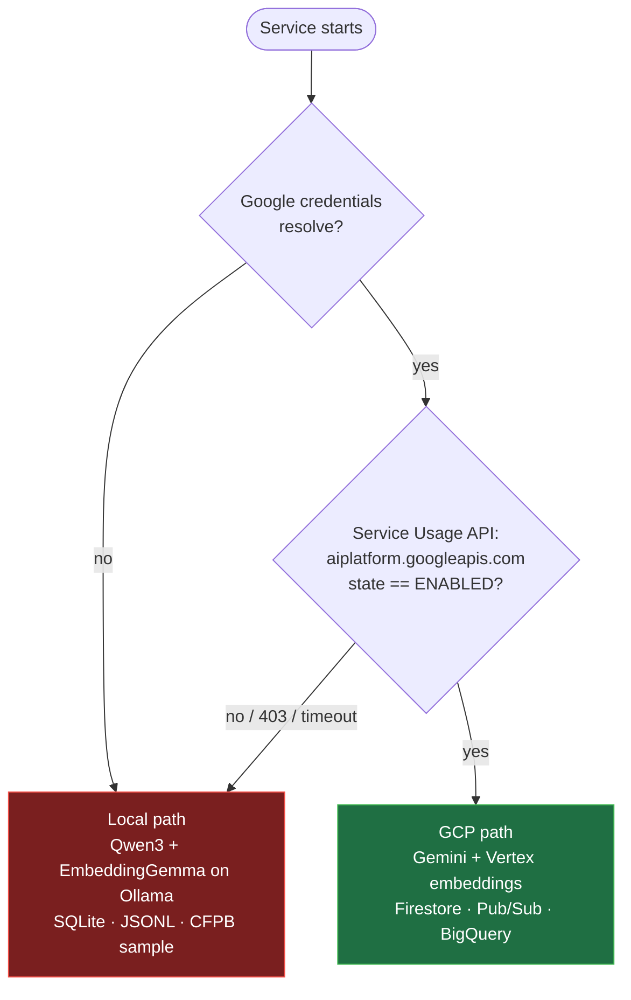
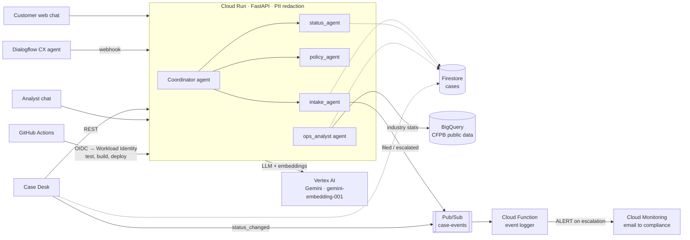

# Northwind Customer Operations (GCP, with a local fallback)

**Live demo: https://complaint-agent-1045201542246.us-central1.run.app** (public, no sign-in;
[`/health`](https://complaint-agent-1045201542246.us-central1.run.app/health) shows which stack is active).

A customer-operations platform for a fictional retail bank, Northwind. It has three surfaces on one backend:

| Surface | For | What it does |
|---|---|---|
| [Customer assistant](https://complaint-agent-1045201542246.us-central1.run.app/assistant) (also a Dialogflow CX agent) | Customers | A multi-agent **Google ADK** assistant. A coordinator routes each turn to an **intake** agent (triages and files complaints), a **policy** agent (answers from the bank's policy documents using embedding search), or a **status** agent (looks up cases). |
| [Case Desk](https://complaint-agent-1045201542246.us-central1.run.app/desk) | Compliance and operations staff | A queue of cases with urgency and regulation tags (Reg E, Reg Z, RESPA, FCRA, FDCPA). Staff change a case's status and add notes, and every change is published as an event. |
| [Analyst](https://complaint-agent-1045201542246.us-central1.run.app/analyst) | Internal analysts | An ADK agent that answers plain-English questions over Northwind's cases and compares them with the public **CFPB** complaint database in **BigQuery**. |

At startup the service checks whether the **Vertex AI API** is available. If it is, everything runs on
GCP. If not, the same code runs on a local open-source stack:

| | GCP path (green) | Local path (red) |
|---|---|---|
| LLM | Gemini on Vertex AI (`gemini-3.5-flash`) | Qwen3 4B Instruct on Ollama via LiteLLM (`LOCAL_MODEL`) |
| Embeddings (policy search) | Vertex AI `gemini-embedding-001` | EmbeddingGemma on Ollama |
| Cases | Firestore (`northwind-ops` database) | SQLite |
| Case events | Pub/Sub → Cloud Function → Cloud Logging / Monitoring alert | `data/events.jsonl` |
| Industry data | BigQuery `bigquery-public-data.cfpb_complaints` | Bundled CFPB sample (13.5k complaints, [app/data](app/data/)) |

## Architecture

### Runtime check



Any failure on the way (no credentials, no network, no permission, API disabled) counts as "no", so the
service always starts. `FORCE_LOCAL=1` forces the red path. The active path is shown on `/health` and in
the badge on every page.

### Platform on GCP



## What it shows

- **Google ADK multi-agent design.** One coordinator with three specialist sub-agents for customers, and a
  separate internal analyst agent. The tools are plain Python functions ([app/agent.py](app/agent.py)), and
  the same agents run on Gemini or a local model. Only the model object changes.
- **Retrieval over the bank's policy documents** ([app/policies](app/policies/)). Policy sections are
  embedded on first use and searched by cosine similarity. With a handful of documents, this needs no
  vector database.
- **Dialogflow CX integration.** The CX agent, defined in Terraform, sends every turn to
  `/dialogflow/webhook`. The CX session id becomes the ADK session id.
- **Event-driven back office.** Filing, escalation and status changes are published to Pub/Sub. A gen2
  Cloud Function logs each event, and escalations become `ALERT` entries that a log-match alert policy
  emails to compliance.
- **Data.** Cases are stored in Firestore, and the analyst queries the CFPB public dataset in BigQuery
  with parameterised SQL and a cap on bytes billed.
- **Security.**
  - Card numbers and SSNs are redacted before text reaches a model, storage or a note.
  - Each component has its own least-privilege service account.
  - CI/CD has no stored keys: GitHub's OIDC token is exchanged through Workload Identity Federation, and
    only this repository's `main` branch is allowed.
  - The container runs as a non-root user, and inputs are length-capped.
- **Everything is Terraform** ([infra/](infra/)): APIs, Artifact Registry, Cloud Run, Firestore, Pub/Sub,
  Cloud Functions, Dialogflow CX, IAM, Workload Identity Federation and monitoring.
- **Tests and CI** ([tests/](tests/), [.github/workflows/deploy.yml](.github/workflows/deploy.yml)):
  unit tests run on every push and PR. Pushes to `main` build the image, deploy it to Cloud Run, and
  smoke-test that `/health` reports the GCP backend.

## Run it locally (red path)

```bash
ollama pull qwen3:4b-instruct && ollama pull embeddinggemma
python -m venv .venv && .venv/bin/pip install -r requirements.txt
FORCE_LOCAL=1 .venv/bin/uvicorn app.main:app --port 8080
```

Open http://localhost:8080. Cases are stored in `data/cases.db` (seeded with demo cases on first run),
and events go to `data/events.jsonl`. Without `FORCE_LOCAL`, the service uses GCP if your
application-default credentials can see a project with Vertex AI enabled.

In Docker: `docker build -t northwind . && docker run -p 8080:8080 -e FORCE_LOCAL=1 -e OLLAMA_API_BASE=http://host.docker.internal:11434 northwind`.

Tests: `.venv/bin/pip install pytest httpx && .venv/bin/python -m pytest -q`

## Deploy to GCP (green path)

```bash
cd infra
terraform init
terraform apply -var project_id=YOUR_PROJECT -var github_repo=OWNER/REPO [-var alert_email=you@example.com]
```

This creates everything, with a placeholder container on Cloud Run. Then add three GitHub repository
variables and push to `main`:

| Variable | Value |
|---|---|
| `GCP_PROJECT` | your project id |
| `WIF_PROVIDER` | `terraform output -raw wif_provider` |
| `DEPLOYER_SA` | `terraform output -raw deployer_sa` |

To try the Dialogflow CX channel, open the agent in the
[Conversational Agents console](https://conversational-agents.cloud.google.com) and use the simulator.

Cost: Cloud Run and the function scale to zero, and Cloud Run is capped at one instance. A conversation
costs a fraction of a cent, and an analyst industry query scans about 300 MB in BigQuery, well within the
free tier.

## Deliberate limits

This is a demo, so a few production concerns are left out on purpose:

- **The internal tools are public, so anyone can try them.** In production, the Case Desk and Analyst
  would sit behind IAP / Google sign-in, with role-based access.
- **ADK sessions are in memory.** Cloud Run is pinned to one instance with session affinity. In
  production they would go to `DatabaseSessionService` or `VertexAiSessionService`.
- **The BigQuery CFPB dataset ends in March 2023.** The bundled local sample is newer (Nov 2025 to
  Oct 2026) but much smaller.
- **Policy retrieval is in memory.** A larger document set would move to Vertex AI Search or a vector
  index.
- **Terraform state is local.** In production it would live in a GCS backend.

Northwind Bank, its policies and the seeded cases are fictional. The industry figures are real CFPB data.
