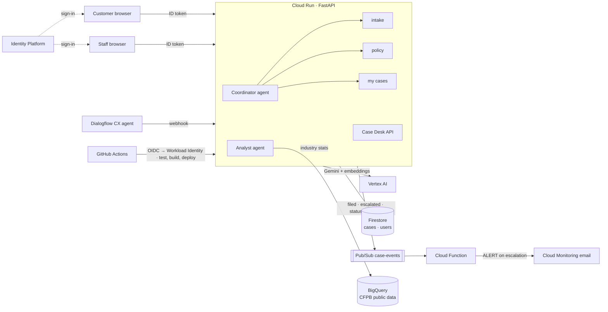
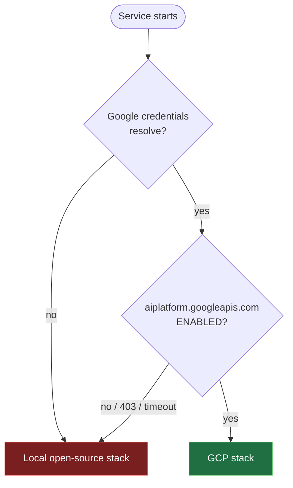

# Northwind Resolve

**Live: https://complaint-agent-1045201542246.us-central1.run.app**

Northwind Resolve is the complaint-handling system of a retail bank. When a customer has a problem with
their money, they tell an AI assistant. The assistant turns it into a case with the right urgency and the
right legal deadline, and a specialist resolves it before that deadline. The customer follows the outcome
without calling in, and managers see where complaints come from.

Northwind Bank is fictional. The regulations, deadlines and industry complaint data are real.

## Who uses it, and how

| Role | Page | What they do there |
|---|---|---|
| Customer | **My account** (`/app`) | Chat with the assistant to ask about fees, disputes or their rights, or to report a problem. Follow their cases and the bank's replies. |
| Complaint specialist | **Case Desk** (`/desk`) | Work the queue of open cases, sorted by legal deadline. Read the AI triage, reply to the customer, add internal notes, change status. |
| Operations or compliance lead | **Insights** (`/insights`) | See deadline risk at a glance, and ask an analyst agent about trends, risky cases, and how Northwind compares with the industry. |

### One complaint, end to end

1. **The customer signs in and describes the problem**, for example "two $480 debit charges I never made".
   A coordinator agent hands the conversation to the intake agent. It asks at most one round of
   questions, then files a case owned by that customer. The case records the product, issue, urgency, and
   the rules that apply (here Reg E).
2. **The case gets its legal deadline.** Reg E errors must be investigated within 10 business days;
   other complaints get the 15-day response the CFPB expects. High-urgency cases publish an `escalated`
   event, and Cloud Monitoring emails the compliance team.
3. **A specialist picks it up in the Case Desk.** Overdue and nearly-due cases sit at the top. The
   specialist replies to the customer ("we've given you a provisional credit…"), adds an internal note,
   and moves it to *in review*. Every status change is published as an event.
4. **The customer sees the reply** under My account, or asks the assistant "where do my cases stand?".
   The status agent can only read that customer's own cases.
5. **The lead watches the trends** in Insights. For example, "2 cases past their legal deadline", or
   "compare our credit card complaints with the industry", answered from BigQuery's CFPB dataset.

Customers can also ask policy questions without filing anything. The policy agent answers from the
bank's policy documents ([app/policies](app/policies/)) using embedding search.

### Try it

On the landing page, click **I'm a customer**. This creates a private throwaway account. Report a
problem, then use **view as staff (demo)** in the header to work your own case in the Case Desk. Switch
back to see the reply land in My account.

## Sign-in and access control

- **Sign-in uses Google Cloud Identity Platform**, with the email/password provider. The demo buttons
  create throwaway accounts through the same provider. The browser uses the Firebase Auth SDK, and the
  server verifies the Identity Platform ID token on every `/api` request.
- **Roles are stored per user.** Everyone starts as a customer. Staff routes (`/api/cases`,
  `/api/stats`, `/api/analyst`) return 403 for customers.
- **Customers only see their own cases.** This is enforced twice:
  - in the API (`/api/my/cases` filters by the signed-in user);
  - inside the agents, whose tools read the user from ADK's `tool_context.user_id`, so the model cannot
    be talked into filing or reading cases for anyone else.
- **Internal notes never leave the staff side.** The customer view of a case strips them out.
- **Card numbers and SSNs are redacted** before text reaches a model, storage, or a staff note.
- **Demo shortcut:** "view as staff" lets any signed-in visitor switch roles so both sides can be tried.
  In production, an administrator would grant the staff role (for example as a custom claim) and staff
  would sign in with the bank's workforce identity.

## How it's built



- **Agents:** Google ADK. The customer assistant is a coordinator with three specialist sub-agents
  (intake, policy, my cases), and the analyst is a separate agent for staff
  ([app/agent.py](app/agent.py)).
- **Case lifecycle:** the deadline rules, the timeline, and what each role may see live in
  [app/cases.py](app/cases.py).
- **Channels:** the web app, plus a Dialogflow CX agent (Conversational Agents) that sends each turn to
  the same coordinator through `/dialogflow/webhook`.
- **Everything is Terraform** ([infra/](infra/)): Cloud Run, Firestore, Pub/Sub, the Cloud Function,
  Dialogflow CX, the sign-in API key, least-privilege service accounts, Workload Identity Federation for
  keyless CI/CD, and the alert policy.

### Runtime check: GCP or a local open-source stack

At startup the service checks whether the Vertex AI API is enabled for its project. If it is, it runs on
GCP. If not (no credentials, no permission, API disabled), it falls back to a local stack, so the same app
runs on a laptop with no cloud account.



| | GCP stack (green) | Local stack (red) |
|---|---|---|
| Sign-in | Identity Platform | Developer sign-in (any email) |
| LLM | Gemini on Vertex AI | Qwen3 4B Instruct on Ollama via LiteLLM |
| Embeddings | Vertex AI `gemini-embedding-001` | EmbeddingGemma on Ollama |
| Cases and users | Firestore | SQLite |
| Case events | Pub/Sub → Cloud Function → Monitoring | `data/events.jsonl` |
| Industry data | BigQuery CFPB dataset | Bundled CFPB sample (13.5k complaints) |

The active stack shows in the badge in the header and on `/health`. `FORCE_LOCAL=1` forces the local
stack.

## Run it locally

```bash
ollama pull qwen3:4b-instruct && ollama pull embeddinggemma
python -m venv .venv && .venv/bin/pip install -r requirements.txt
FORCE_LOCAL=1 .venv/bin/uvicorn app.main:app --port 8080
```

Open http://localhost:8080. Tests: `.venv/bin/pip install pytest httpx && .venv/bin/python -m pytest -q`

## Deploy your own

1. In the project, enable Identity Platform with the **Email/Password** provider (Console → Identity
   Platform → Providers). This is a project-wide setting, so Terraform leaves it alone.
2. Run:
   ```bash
   cd infra && terraform init
   terraform apply -var project_id=YOUR_PROJECT -var github_repo=OWNER/REPO [-var alert_email=you@example.com]
   ```
3. Add the GitHub repository variables `GCP_PROJECT`, `WIF_PROVIDER` (`terraform output -raw wif_provider`)
   and `DEPLOYER_SA` (`terraform output -raw deployer_sa`), then push to `main`. CI runs the tests,
   builds the image, deploys it to Cloud Run, and checks that `/health` reports the GCP stack.

## Deliberate limits

- **The role switch is a demo affordance, not access control you would ship.** See "Sign-in and access
  control" above.
- **ADK sessions are in memory**, with Cloud Run pinned to one instance. Production would use
  `VertexAiSessionService` or a database session store.
- **The BigQuery CFPB dataset ends in March 2023.** The bundled local sample is newer (Nov 2025 to
  Oct 2026) but smaller.
- **Business-day deadlines skip weekends but not federal holidays.**
- **Terraform state is local.** Production would keep it in a GCS backend.
