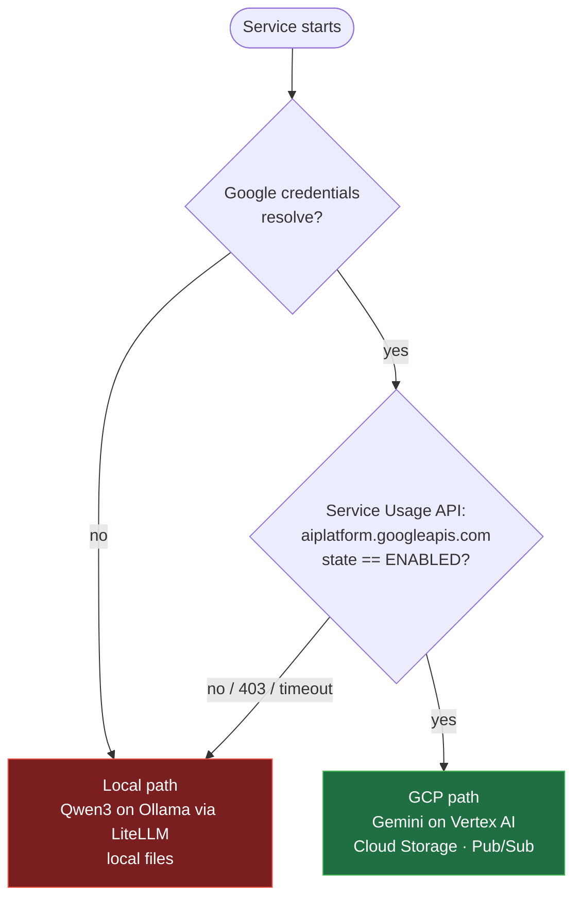
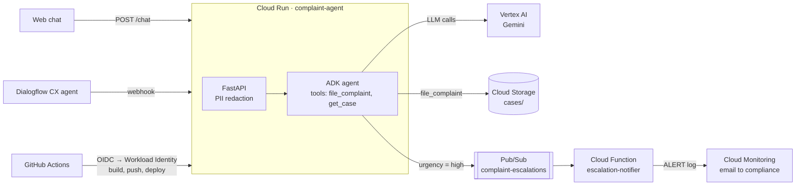

# Complaint intake agent (GCP, with a local fallback)

A conversational agent that a retail bank could put in front of customers to take complaints. It asks a
couple of follow-up questions, triages the complaint (product, issue, urgency, which US consumer-finance
rules may apply) and files a case. Urgent cases (fraud, frozen funds, imminent foreclosure) go to the
compliance team right away.

**Live demo: https://complaint-agent-1045201542246.us-central1.run.app** (public, no sign-in;
[`/health`](https://complaint-agent-1045201542246.us-central1.run.app/health) shows which path is active).

The agent is built with **Google ADK**, served from **Cloud Run**, and reachable from a web chat or a
**Dialogflow CX** agent. At startup the service checks whether the **Vertex AI API** is available.
If it is, everything runs on GCP. If not, the same code runs on a local open-source stack.

| | GCP path (green) | Local path (red) |
|---|---|---|
| Model | Gemini on Vertex AI (`gemini-3.5-flash`) | Qwen3 4B Instruct on Ollama (`qwen3:4b-instruct`; any tool-capable model via `LOCAL_MODEL`) |
| Case storage | Cloud Storage bucket | `data/cases/*.json` |
| Escalation queue | Pub/Sub → Cloud Function → Cloud Monitoring email alert | `data/escalations.jsonl` |

## Architecture

### Runtime check



Any failure on the way (no credentials, no network, no permission, API disabled) counts as "no", so the
service always starts. `FORCE_LOCAL=1` forces the red path. The result is shown on `/health` and as a
badge on the chat page.

### Request flow on GCP



## What it shows

- **Google ADK agent with tools.** `file_complaint` and `get_case` are plain Python functions
  ([app/agent.py](app/agent.py)). The same `Agent` object runs on Gemini or a local Ollama model; only the model
  argument changes.
- **Dialogflow CX integration.** A CX agent defined in Terraform sends greetings and unmatched input to
  the `/dialogflow/webhook` endpoint. The CX session id becomes the ADK session id, so a conversation
  keeps its context across turns.
- **Event-driven escalation.** Pub/Sub, then a gen2 Cloud Function, then a structured `ALERT` log, then
  a log-match alert policy that emails the compliance team.
- **Security.**
  - Card numbers and SSNs are redacted before text reaches the model or storage.
  - Each component has its own service account, with roles granted on the specific bucket or topic
    where possible.
  - CI/CD has no stored keys: GitHub's OIDC token is exchanged through Workload Identity Federation,
    and only the `main` branch of this repository is allowed.
  - Buckets block public access, and the container runs as a non-root user.
- **Everything is Terraform** ([infra/](infra/)): APIs, Artifact Registry, Cloud Run, Cloud Storage,
  Pub/Sub, Cloud Functions, Dialogflow CX, IAM, Workload Identity Federation and monitoring.
- **Tests and CI** ([tests/](tests/), [.github/workflows/deploy.yml](.github/workflows/deploy.yml)):
  unit tests run on every push and PR. Pushes to `main` build the image, deploy it, and smoke-test that
  `/health` reports the GCP backend.

## Run it locally (red path)

```bash
ollama pull qwen3:4b-instruct
python -m venv .venv && .venv/bin/pip install -r requirements.txt
FORCE_LOCAL=1 .venv/bin/uvicorn app.main:app --port 8080
```

In Docker: `docker build -t complaint-agent . && docker run -p 8080:8080 -e FORCE_LOCAL=1 -e OLLAMA_API_BASE=http://host.docker.internal:11434 complaint-agent`.

Open http://localhost:8080. Filed cases appear in `data/cases/` and escalations in
`data/escalations.jsonl`. Without `FORCE_LOCAL`, the service uses Vertex AI if your
application-default credentials can see a project with the API enabled.

Tests: `.venv/bin/pip install pytest httpx && .venv/bin/pytest -q`

## Deploy to GCP (green path)

```bash
cd infra
terraform init
terraform apply -var project_id=YOUR_PROJECT -var github_repo=OWNER/REPO [-var alert_email=you@example.com]
```

This creates everything, with a placeholder container on Cloud Run. Then add three GitHub repository
variables from the Terraform outputs and push to `main`:

| Variable | Value |
|---|---|
| `GCP_PROJECT` | your project id |
| `WIF_PROVIDER` | `terraform output -raw wif_provider` |
| `DEPLOYER_SA` | `terraform output -raw deployer_sa` |

The workflow builds the image, deploys it, and checks that `/health` says `"backend": "gcp"`. To try the
Dialogflow CX channel, open the agent in the
[Conversational Agents console](https://conversational-agents.cloud.google.com) and use the simulator.

Cost: Cloud Run and the function scale to zero, and Cloud Run is capped at one instance. A demo
conversation costs a fraction of a cent in Gemini calls.

## Deliberate limits

This is a demo, so a few production concerns are left out on purpose:

- **Sessions are in memory.** Cloud Run is pinned to one instance with session affinity. In production
  they would go to ADK's `DatabaseSessionService` or `VertexAiSessionService`.
- **The service is public, so anyone with the link can chat.** In production it would sit behind
  authentication, with rate limits or Cloud Armor in front.
- **Terraform state is local.** In production it would live in a GCS backend.

Sample complaints in the chat are written for the demo. The product categories follow the
[CFPB consumer complaint database](https://www.consumerfinance.gov/data-research/consumer-complaints/).
